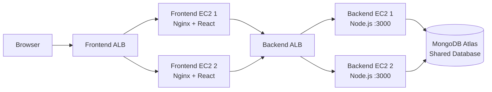

# TravelMemory | AWS Deployment Architecture

## Architecture Diagram

## Components

| Component | Purpose |
|---|---|
| Browser | Client accessing the TravelMemory application. |
| Frontend ALB | Distributes incoming traffic across the frontend EC2 instances. |
| Frontend EC2 1 & 2 | Host the React frontend served through Nginx. |
| Backend ALB | Routes API traffic to the backend EC2 instances. |
| Backend EC2 1 & 2 | Run the Node.js backend on port 3000. |
| MongoDB Atlas | Shared database accessed by both backend instances. |

## Traffic Flow

1. The browser sends a request to the Frontend Application Load Balancer (ALB).
2. The Frontend ALB forwards the request to one of two frontend EC2 instances running Nginx and React.
3. Frontend requests requiring backend services are directed to the Backend ALB.
4. The Backend ALB distributes API requests across two Node.js backend EC2 instances listening on port 3000.
5. Both backend instances connect to the shared MongoDB Atlas database.

> This Markdown document is derived from the supplied draw.io diagram. It represents the depicted architecture; it does not assert additional infrastructure configuration.
